# A lightweight deep neural network for automatic modulation classification based on dual-layer group Lasso

Run results
\n        \n  
Abstract: Automotive Modulation Classification (AMC) is a hot topic in modern wireless communication, essentially a classification problem. Deep learning methods have been gradually applied to AMC due to their excellent performance in tasks such as classification, regression, and decision-making. However, deep learning methods often suffer from complex network structures, massive training parameters, and excessively long training times, severely limiting their application and promotion on power-constrained devices. In this paper, we propose a lightweight end-to-end AMC model called Lightweight Deep Neural Network (LDNN), which utilizes a novel group-level sparse induced norm to help the network automatically prune itself for highly compact networks. To address the recognition issues of confusion types like QAM 16 and QAM 64 in the AMC task, an improved two-step training lightweight deep neural network (TLDNN) is designed to enhance recognition accuracy. Experimental results show that by employing dual regrouping truncation regularization and a two-step training plan, the proposed lightweight compact network achieves higher accuracy.
Keywords: Auto-modulation classification, Group sparsity, Lightweight, Deep network
I. Introduction
Automatic Modulation Classification (AMC) is a significant research topic in modern wireless communication, playing a crucial role in cognitive communication and cognitive interference applications [1]. In cognitive radio (CR), the CR transmitter needs to automatically select the modulation method based on the external environment, while the CR receiver needs to independently determine the signal modulation method. In software-defined radio (SDR), AMC technology can quickly adapt to complex and variable communication systems without protocol overhead. In a cognitive interference environment, modern devices need to automatically discover the modulation modes used by friendly signals and enemy signals.
Traditional AMC algorithms mainly fall into two categories: likelihood-based AMC and feature-based AMC. The likelihood-based AMC algorithm obtains classification results by obtaining decision thresholds from observation waveforms, comparing the likelihood ratio of each possible hypothesis with the threshold to obtain prediction results [3] and [4]. Traditional feature-based AMC algorithms [5] and [6] include three steps: data preprocessing, feature extraction, and classification. However, these traditional AMC algorithms cannot be applied in low-cost real-time implementations. The likelihood-based AMC algorithm has high computational complexity [7], while traditional feature-based AMC algorithms perform poorly without expert knowledge and manual design.
In recent years, deep learning has shown excellent performance in classification, regression, and decision tasks. Of course, it has gradually been introduced to AMC [8]-[12]. In [8], convolutional neural networks (CNN) were designed to distinguish ten different modulation types. In [9], a new method for AMC tasks based on grid constellation matrices (GCN) was proposed through comparison with full convolutional networks (CFCN). However, deep learning methods have an undeniable issue, that is, complex network models, large training parameters, and long training times, which severely affect their application. Traditional deep neural networks (DNN) have redundant weights, which increases the risk of overfitting. These redundant weights are the main bottleneck in parallel implementations of gradient descent [13]. Moreover, research has proven that most weights are unnecessary for maintaining accuracy in deep networks [14] and [15]. Therefore, existing CFCN and DNN networks face the problem of long training times, hindering their application in power-constrained embedded devices. For this reason, lightweight networks are essential for real-time AMC applications.
Some researchers have been working on preserving training time without sacrificing accuracy, and addressing the issue of confusion types in AMC recognition. In [16], Principal Component Analysis (PCA) and subsampling techniques were successfully applied to AMC, significantly reducing training time while maintaining classification accuracy to an insignificant degree. However, this method requires significant memory space for storage and computation. In [17], connections from the same neuron are considered a group, and when all coefficients of a neuron's group are set to zero, it can be deleted. In [18], a date-driven deep learning approach was proposed for QAM16 and QAM64 classification, specifically designed for small tasks.
Inspired by the group sparsity induced by the group tethering technique, this paper proposes a lightweight AMC DNN based on group tethering that learns pruning through automatic deletion of neurons in hidden layers.
Our contributions are summarized as follows:
·We propose a lightweight neural network design method using group sparsity induction regularization. Considering the multifaceted nature of hidden layer neurons (hidden layer neurons receive data from the previous layer and transmit data to the next layer), we treat the incoming connections forming a neuron and the outgoing connections forming a group as one entity, greatly promoting the lightweight design of neural networks.
·We designed an end-to-end trainable DNN for the AMC task. Our method allows the network to automatically prune itself during training, which significantly reduces the size of the network but leads to a decrease in accuracy.
·We introduced a two-step training method to address the problem of confusion type recognition, such as QAM16 and QAM16 frequently confused in AMC, which focuses more attention on the confusing data, significantly improving recognition accuracy. Moreover, a convergent network is designed to select confusion classes during training by generating an index vector.
The rest of the paper is organized as follows. Section 2 and 3 outline the proposed DNN-based AMC and two-step training methods. Section 4 presents simulation results followed by some analyses. Finally, Section 5 introduces conclusions and discussions.
Figure 1. Group sparsity in the LDNN model from different perspectives: network, neurons, and parameters (from left to right). In the left image, group sparsity occurs between the input connection wk I and the output connection wk O. The components within the yellow frame are magnified in the middle image. The green dashed line represents the removed connections, and if all incoming or outgoing connections are set to zero during training, the green neurons can be removed. In the right image, we show the parameter matrix of the kth layer, indicating the removed connections as green.
Section II. Waveform Recognition Based on Group Sparsity in Deep Neural Networks
In this section, we propose a lightweight DNN using dual-group slackness regularization. The proposed LDNN model with group sparsity can be viewed from three aspects: network view, neuron view, and parameter view, as shown in Figure 1. During training, by removing neurons if all incoming or outgoing connections are zero, we can compress the network.
A. Group Lasso Regularization
So far, the most popular choice for regularization functions in deep learning literature is the l2 norm, represented as "weight decay" or "Tikhonov regularization," defined as follows:
It should be noted that the l2-norm penalty cannot induce sparsity [19]. Therefore, l1 norm regularization, also known as "Lasso" regularization, is introduced to induce sparsity, as given below:
Compared to the l2-norm penalty function, the l1-norm penalty function has the highest weight for small residuals and the lowest weight for large residuals. By minimizing the objective function with l1 norm regularization, we obtain solutions with many equal to zero components [19]. In other words, l1-norm regularization leads to individual sparsity.
However, in lightweight neural networks, achieving a compact network objective prompts us to seek group-level sparsity rather than individual sparsity promoted by the l1 norm. Generally, neurons can only be removed when all incoming or outgoing connections are set to zero during training. In this case, neither the l2-norm nor the l1-norm is our best choice because the former cannot induce sparsity and the latter can only promote individual sparsity.
The key idea of our lightweight network is to leverage group-level sparsity to force simultaneous removal of these connections from a neuron. The hybrid l1/lasso regularization, known as "Group Lasso" regularization, is widely used in induced group sparsity in compression sensing [20], [21] and is given by the following equation:
where wp = wp 1, wp 2, ...wpNp is the predefined group with Np parameters in w, p = 1, ..., P is the group exponent; cp is the scalar factor.
In the next section, by integrating the modified group-lasso regularization into an AMC based on DNN, we can learn the lightweight network through automatic removal of neurons.
B. Proposed Lightweight DNN (LDNN) Model with Dual Group Lasso Regularization
Considering the multifaceted nature of hidden layer neurons (hidden layer neurons receive data from the previous layer and transmit it to the next layer), treating the incoming connections and outgoing connections forming a neuron as a group greatly facilitates the design of neural networks for lightweight purposes.
Applying group sparsity to the optimal coefficient vector wk O (the set of outgoing connections of the kth layer) and wk I (the set of incoming connections of the kth layer), we have
The following is the translation of the Chinese text into English:
Among them, Nk represents the number of neurons in the kth layer, where k ∈ {0, 1, 2, ...}. When k = 0, it represents the input layer; when k = K, it represents the output layer; wk Opq represents the coefficient from the pth neuron in the kth layer to the qth neuron in the (k+1)th layer. Given vector wk Opp = [wk Op 1,...,wk OpNk+1] forms a group. In our proposed LDNN model, when the coefficients in the vector wk Op are set to zero simultaneously, the corresponding neuron (the pth neuron in the kth layer) will be removed.
Let {(r1, m1), (r2, m2), ..., (rT, mT)} represent a general training set with T examples, where ri is the input vector and mi is the label (modulation type). Through minimizing the following objective function to train the LDNN model:
where L(·,·) is the cross-entropy loss. Let R(·) be defined as "dual group lasso regularization," given by the formula below:
Then, the objective function in equation (5) becomes:
As shown in Figure 2, the proposed LDNN model uses ReLU activation functions in the hidden layers and Softmax functions in the last fully connected layer. By applying group lasso regularization, we reduce most neurons and eventually learn the probability distribution through the Softmax function.
Figure 2. Lightweight DNN model with Twofold Group Lasso regularization. Uses ReLU activation functions in the hidden layers and Softmax functions in the last fully connected layer to obtain the probability distribution.
III. Improved Two-Step Training Lightweight Deep Neural Network (TLDNN)
There are two challenging issues that cannot be overlooked. On one hand, it is difficult to distinguish between confusing modulation types, such as QAM 16 and QAM 64 [18]. On the other hand, we always need to balance recognition accuracy with training time consumption. To this end, we propose an improved two-step training lightweight deep neural network (TLDNN), as shown in Figure 3. By having a lightweight auxiliary network focus on the type of confusion, which is a simple but useful technique, we have LDNN 1 for coarse training, LDNN2 for fine training, and a fused network for information fusion.
Figure 3 presents the improved two-step training lightweight deep neural network. During the training phase, a confusion matrix of size M×M is sent to the converged network in step 1, and then converted into index signals for limiting the training data of LDNN 2 in step 2. In the testing phase, waveforms of size 2×128 IQ samples will be directly sent to LDNN 1 and LDNN 2, and the fused network will merge predictions to obtain the final result.
A. Two-Step Training Method
1) The first step: 2×128 coherent and quadrature (IQ) samples are sent to LDNN 1 model for training a compact network structure through dual-group Lasso regularization in (7). Then, the trained CM×M confusion matrix generated by LDNN 1 is sent to the converged network, which automatically generates an index signal s to indicate the confusion classes for training LDNN 2 model.
2) The second step: The index signal s from the converged network is used to filter the original training dataset, so only M2 modulation type signals are sent to LDNN 2. LDNN 2 shares the same structure with LDNN 1, but focuses more on the confusing modulation types, generating soft predictions for these M2 modulation types.
B. Fused Network
The fused network serves as a bridge between steps 1 and 2, playing different roles during training and testing stages. Considering a M-class problem, without loss of generality, the relationship between M2, M1, and M is given by M = M1 + M2.
In the training phase, the converged network uses two predefined parameters Bh and Bl to describe the confusion matrix from the trained LDNN 1. Each element in the confusion matrix is related to two modulation types: true modulation type and predicted modulation type. The diagonal elements and non-diagonal elements of the modulation types less than Bh are reclassified as confusion types. Then, the index signal s generated by the converged network is an M-dimensional vector consisting of 0s and 1s, representing non-confusion modulation types and confusion modulation types respectively.
In the testing phase, when an unknown waveform arrives, the fusion network receives both predictions from LDNN 1 and LDNN 2 simultaneously. Using the index signal s generated during the training phase, we select the non-confusion modulation types from the predictions of LDNN 1. We then retain the confusion modulation types for merging with the predictions of LDNN 2 to obtain the final soft prediction results.
IV. Experiments and Discussion
A. Experimental setup
The proposed method was evaluated on the RML2016.10b dataset generated in GNU Radio [8]. The training example to test example ratio was 7:3. We used the adaptive moment estimation (Adam) optimization method with a learning rate of 0.001 to search for optimal network parameters.
B. Contribution of LDNN based on Group Lasso
See Figure 4. Results of the RML2016.10b dataset, all five penalty periods ranging from 50 to 1000. (a) Test neuron and period, (B) Test accuracy and period.
1. Initially, we evaluate our LDNN model and compare five neural networks, each using Lasso regularization (represented as L1-DNN) [22], weight decay (represented as L2-NN) [23], Group Lasso regularization (represented as GL-NN) [17], Sparse Group Lasso regularization (represented as SGL-NN) [17], and the Twofold Group Lasso regularization (LDNN) proposed in Section (7). In all cases, we used the same network structure mentioned in Section II-B, starting from left to right, with five hidden layers each having 500, 400, 300, 200, and 100 neurons respectively. We ran the optimization algorithm for 1000 epochs with a regularization factor λ=10^-5. After training, all weights with absolute values less than 10^-3 were set to zero.
The results of this set of experiments are shown in Figure 4. Here are some key observations: From Figure 4a, we can see that SGL-NN [17] requires the fewest number of neurons, followed by LDNN, indicating it has the lowest network complexity. In Figure 4b, we can observe that L2-NN achieves the best performance based on overall test accuracy, which seems to be the optimal result for a DNN model. LDNN comes second with the highest precision, followed by L2-NN. Considering both Figure 4a and Figure 4b, SGL-NN performs best in the task of removing neurons, but performs poorly in terms of test accuracy. L2-NN performs best in terms of test accuracy, but poorly in the task of removing neurons. Considering both recognition accuracy and reduction in network complexity, LDNN performs best.
C. Contributions of Two-Step Training
Figure 5. Contribution of two-step training, setting Bh = 75% and Bl = 20% (a) confusion matrix for LDNN1, (b) confusion matrix for TLDNN (LDNN1 uses two-step training method).
Figure 5 (a) shows the results of LDNN 1 in terms of confusion matrices. Figure 5 (B) displays the results of LDNN 1 using two-step training methods, from which we can see that the converged network effectively improves performance.
Table I Results of Two-Step Training Method
Table I presents additional results regarding the converged network, with different average test accuracy, number of trainable parameters, sparsity per layer, and number of neurons per layer. L1 NN, L2-NN, and LDNN 1 share the same parameters as in the previous section. L1-NN+Two-Step Training, L2-NN+Two-Step Training, and LDNN 1+Two-Step Training (TLDNN) represent the fused networks by combining the confusion classifier (LDNN 2) with L1-NN, L2-NN, and LDNN 1 respectively. The results show that the fused networks significantly improve accuracy performance from 76.96% to 85.30% (L1-NN), 79.60% to 85.60% (L2-NN), and 77.68% to 85.68% (LDNN 1). It is also evident from Table I that the proposed LDNN 1 and TLDNN both have high test accuracy and highly compact network structures, i.e., smaller number of trainable parameters and neurons compared to other methods.
Conclusion
In this paper, we introduce a method to obtain a lightweight, compact network through our dual-group tethering regularization. Then, we propose an end-to-end AMC model LDNN that can automatically prune itself during training. To address the issue of type recognition confusion and potential performance limitations brought by lightweight networks in AMC, we design a new TLDNN model using two-step training methods, which significantly improves recognition accuracy. Experimental results indicate that the algorithm has superior performance in obtaining a compact network, which is significant for its application and promotion in power-constrained and resource-constrained environments such as the Internet of Things (IOT). For future work, we are interested in further breaking the performance boundaries of lightweight networks.
Code Exhibits
import torch\nimport torch.nn.functional as F\nimport torch.optim as optim\nimport models\nimport time\nimport itertools\nimport numpy as np\nfrom torch.utils.data import DataLoader\nimport matplotlib.pyplot as plt\nfrom torch import nn\nfrom utils import Regularization\nfrom data import RML2016b\ntorch.__version__\n​\n# Parameter definition\nBATCH_SIZE = 1024\nEPOCHS = 1000\nweight_decay = 10**-4.5\nR_TYPE = 5  # 1 for L1 norm, 2 for L2 norm, 3 for GL norm, 4 for SGL norm, 5 for TGL norm\nLEARN_RATE = 0.001\nMODEL1_PATH = 'checkpoints/LDNN1.pth'\nMODEL2_PATH = 'checkpoints/ConfNet.pth'\nIs_load_main_model = 1  # 0 for no load, 1 for load trained model from MODEL1_PATH\nIs_load_conf_model = 1  # 0 for no load, 1 for load trained model from MODEL2_PATH\nIs_train_main_model = 0  # 0 for use trained main_model form MODEL1_PATH, 1 for trained main_model from scratch\nIs_train_conf_model = 0  # 0 for use trained main_model form MODEL2_PATH, 1 for trained conf_model from scratch\nBh = 0.75\nBl = 0.20\nDEVICE = torch.device("cuda" if torch.cuda.is_available() else "cpu")  # try to use GPU\nprint(DEVICE)\n​\n​\n#  Initialization\ndef weight_init(m):\n    if isinstance(m, nn.Linear):\n        m.weight.data.normal_(0, 0.1)\n        m.bias.data.zero_()\n​\n​\ndef train(model, device, train_loader, optimizer, epoch, reg_loss):\n    model.train()\n    for batch_idx, (data, target) in enumerate(train_loader):\n        data, target = data.to(device), target.to(device)\n        optimizer.zero_grad()\n        output = model(data)\n        loss = F.nll_loss(output, target)\n        if weight_decay > 0:\n            loss = loss + reg_loss(model)\n        else:\n            print("no regularization")\n        loss.backward()\n        optimizer.step()\n        time_now = time.time()\n        if(batch_idx+1) % 30 == 0:\n            print('Train Epoch: {} [{}/{} ({:.0f}%)]\tLoss: {:.6f}\ttime={:.2f}s'.format(\n                epoch, batch_idx * len(data), len(train_loader.dataset),\n                100. * batch_idx / len(train_loader), loss.item(), time_now-time_begin))\n​\n​\ndef test(model, device, test_loader):\n    model.eval()\n    test_loss = 0\n    correct = 0\n    with torch.no_grad():\n        for data, target in test_loader:\n            data, target = data.to(device), target.to(device)\n            output = model(data)\n            test_loss += F.nll_loss(output, target, reduction='sum').item()\n            pred = output.max(1, keepdim=True)[1]\n            correct += pred.eq(target.view_as(pred)).sum().item()\n    time_epoch = time.time()\n    test_loss /= len(test_loader.dataset)\n    print('\nTest set: Average loss: {:.4f}, Accuracy: {}/{} ({:.2f}%),time:{:.2f}s\n'.format(\n        test_loss, correct, len(test_loader.dataset),\n        100. * correct / len(test_loader.dataset), time_epoch-time_epoch0))\n​\n​\n#  Define confusion matrix calculation function\ndef confusion_matrix(model, conf_matrix, converge=False):\n    with torch.no_grad():\n        correct = 0\n        for data, target in test_loader:\n            data, target = data.to(DEVICE), target.to(DEVICE)\n            if converge:\n                predict = model(data)\n            else:\n                output = model(data)\n                predict = torch.argmax(output, 1)\n            correct += predict.eq(target.view_as(predict)).sum().item()\n            for t, p in zip(target, predict):\n                conf_matrix[t, p] += 1\n        conf_matrix = conf_matrix.astype('float') / conf_matrix.sum(axis=1)[:, np.newaxis]\n        if converge:\n            print('\nTest set: Converged Accuracy: {}/{} ({:.2f}%)\n'.format(\n                correct, len(test_loader.dataset),\n                100. * correct / len(test_loader.dataset))\n)        else:\n            print('\nTest set: Main_model Accuracy: {}/{} ({:.2f}%)\n'.format(\n                correct, len(test_loader.dataset),\n                100. * correct / len(test_loader.dataset))\n)    return conf_matrix\n​\n​\ndef plot_confusion_matrix(cm, classes, normalize=False, title='Confusion matrix', cmap=plt.cm.Blues):\n    """\n        This function prints and plots the confusion matrix.\n        Normalization can be applied by setting `normalize=True`.\n        Input\n        - cm : confusion matrix\n        - classes : the classes\n        - normalize : True:show as percentage, False:show as norm\n    """\n    if normalize:\n        cm = cm.astype('float') / cm.sum(axis=1)[:, np.newaxis]\n        print("Normalized confusion matrix")\n    else:\n        print('Confusion matrix, without normalization')\n    # print(cm)\n    plt.imshow(cm, interpolation='nearest', cmap=cmap)\n    plt.title(title)\n    plt.colorbar()\n    tick_marks = np.arange(len(classes))\n    plt.xticks(tick_marks, classes, rotation=45)\n    plt.yticks(tick_marks, classes)\n    fmt = '.2f' if normalize else 'd'\n    thresh = cm.max() / 2.\n    for i, j in itertools.product(range(cm.shape[0]), range(cm.shape[1])):\n        plt.text(j, i, format(cm[i, j], fmt),\n                 horizontalalignment="center",\n                 color="white" if cm[i, j] > thresh else "black"\n)    plt.tight_layout()\n    plt.ylabel('True label')\n    plt.xlabel('Predicted label')\n    plt.show()\n​\n​\ndef converged_net(data):\n    out_main = model_main(data)\n    predict_main = torch.argmax(out_main, 1)\n    predict_fine = predict_main\n    for i in range(0, predict_fine.size(0) - 1):\n        if predict_main[i] in conf_num:\n            out_conf = model_conf(data)\n            predict_conf = torch.argmax(out_conf, 1)\n            predict_fine[i] = conf_num[int(predict_conf[i])]\n    return predict_fine\n​\n​\n# Step1: train the main network\nprint("\nStep1: train the main network")\ntrain_dataset = RML2016b(train=True)\ntrain_loader = DataLoader(train_dataset,\n                          batch_size=BATCH_SIZE,\n                          shuffle=True,\n                          num_workers=2\n)test_dataset = RML2016b(train=False)\ntest_loader = DataLoader(test_dataset,\n                         batch_size=BATCH_SIZE,\n                         shuffle=True,\n                         num_workers=2\n)​\n#  Model and optimizer\nmodel_main = models.DnnNet0()\nmodel_main.apply(weight_init)\nmodel_main = model_main.to(DEVICE)\nif Is_load_main_model:\n    model_main.load(MODEL1_PATH)\n​\nif Is_train_main_model:\n    #  Regularization\n    reg_loss_main = 0\n    if weight_decay > 0:\n        reg_loss_main = Regularization(model_main, weight_decay, p=R_TYPE).to(DEVICE)\n    else:\n        print("no regularization")\n​\n    optimizer_main = optim.Adam(model_main.parameters(), lr=LEARN_RATE)\n    scheduler_main = optim.lr_scheduler.MultiStepLR(optimizer_main, milestones=[500, 800], gamma=0.1)\n​\n    time_begin = time.time()\n    for epoch in range(1, EPOCHS + 1):\n        time_epoch0 = time.time()\n        train(model_main, DEVICE, train_loader, optimizer_main, epoch, reg_loss_main)\n        scheduler_main.step()\n        test(model_main, DEVICE, test_loader)\nelse:\n    print("use the trained network as the main network")\n​\nmodel_main.save('checkpoints/MNet_LDNN.pth')\n​\n# Converged network: describe the confusion matrix from the trained main_model\nprint('\nConverged network: the training phase')\nclasses = test_dataset.classes\nconf_matrix = np.zeros((len(classes), len(classes)))\nconf_matrix = confusion_matrix(model_main, conf_matrix)\nconfusion_num = []\nconfusion_class = []\nfor i in range(0, len(classes)):\n    for j in range(0, len(classes)):\n        if i == j:\n            if conf_matrix[i, j] < Bh:\n                confusion_num.append(i)\n                confusion_class.append(classes[i])\n        if i != j:\n            if conf_matrix[i, j] > Bl:\n                confusion_num.append(i)\n                confusion_class.append(classes[i])\n                confusion_num.append(j)\n                confusion_class.append(classes[j])\nconf_num = np.unique(confusion_num)\nconf_num = conf_num.tolist()\nconf_class = np.unique(confusion_class)\nconf_class = conf_class.tolist()\nprint("The confusion classes:", conf_class)\n​\n# Step2: fine training\nprint('\nStep2: fine training')\nmodel_conf = models.DnnNet0()\nmodel_conf.apply(weight_init)\nmodel_conf = model_conf.to(DEVICE)\nif Is_load_conf_model:\n    model_conf.load(MODEL2_PATH)\n​\nif Is_train_conf_model:\n    fine_train_dataset = RML2016b(train=True, fine_train=True, conf_class=conf_class)\n    fine_train_loader = DataLoader(fine_train_dataset,\n                                   batch_size=BATCH_SIZE,\n                                   shuffle=True,\n                                   num_workers=2\n)    fine_test_dataset = RML2016b(train=False, fine_train=True, conf_class=conf_class)\n    fine_test_loader = DataLoader(fine_test_dataset,\n                                  batch_size=BATCH_SIZE,\n                                  shuffle=True,\n                                  num_workers=2\n)    #  Regularization\n    reg_loss_conf = 0\n    if weight_decay > 0:\n        reg_loss_conf = Regularization(model_conf, weight_decay, p=R_TYPE).to(DEVICE)\n    else:\n        print("no regularization")\n​\n    optimizer_conf = optim.Adam(model_conf.parameters(), lr=LEARN_RATE)\n    scheduler_conf = optim.lr_scheduler.MultiStepLR(optimizer_conf, milestones=[500, 800], gamma=0.1)\n​\n    time_begin = time.time()\n    for epoch in range(1, EPOCHS + 1):\n        time_epoch0 = time.time()\n        train(model_conf, DEVICE, fine_train_loader, optimizer_conf, epoch, reg_loss_conf)\n        scheduler_conf.step()\n        test(model_conf, DEVICE, fine_test_loader)\nelse:\n    print("use the trained network as the confuse network")\n​\nmodel_conf.save('checkpoints/CNet_LDNN.pth')\n​\n# Converged network\nprint('\nConverged network: the testing phase')\nclasses = test_dataset.classes\nconf_matrix = np.zeros((len(classes), len(classes)))\nconf_matrix = confusion_matrix(converged_net, conf_matrix, converge=True)\nplot_confusion_matrix(conf_matrix, classes=classes, normalize=True, title='Normalized confusion matrix')\n  
​  

## Images

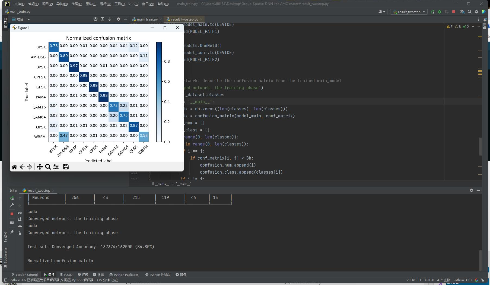
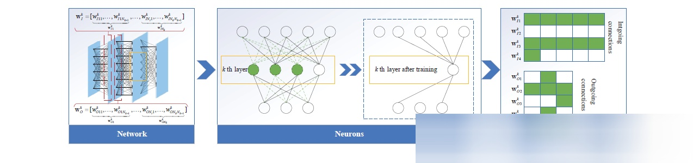
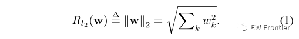
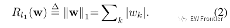
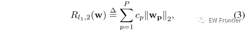
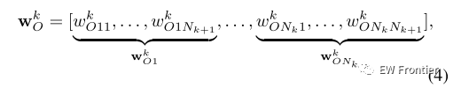
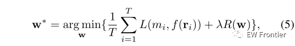
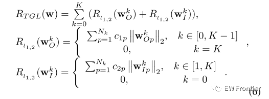
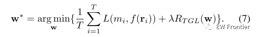

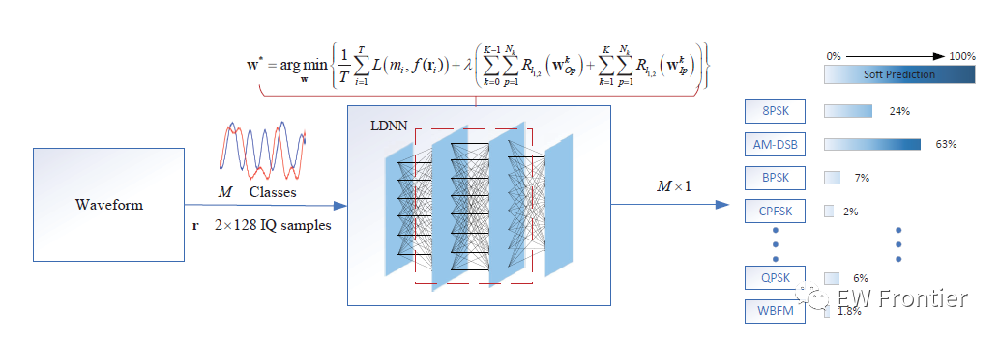
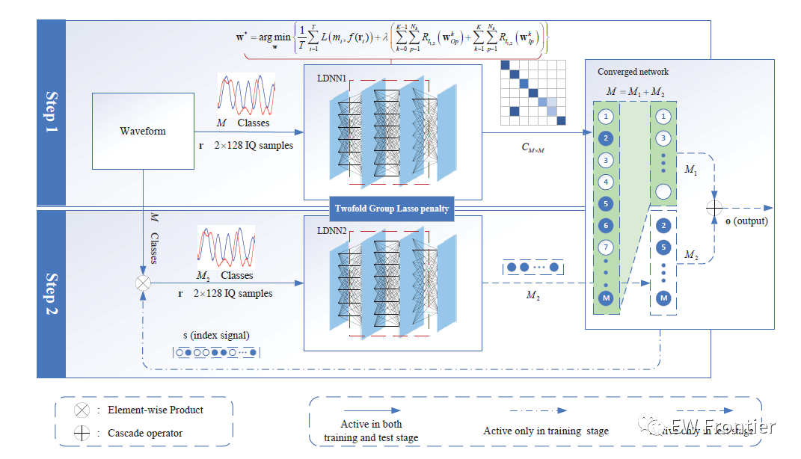
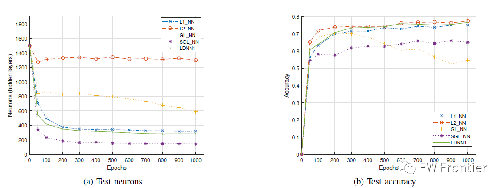
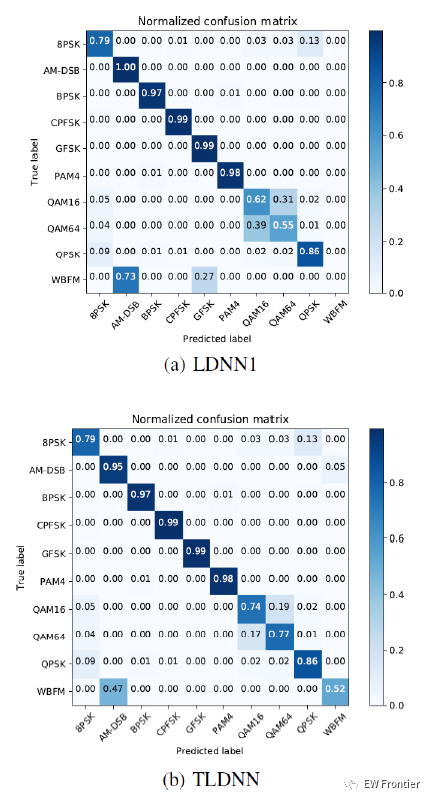
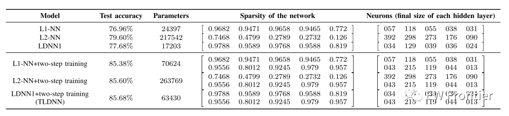

<!-- PAYMENT_BLOCK -->

## Get this dataset

- Payment link (Stripe): [Buy now](https://buy.stripe.com/3cs8yP7sY87d0vu9AB)
- Payment QR code: 

<!-- /PAYMENT_BLOCK -->
